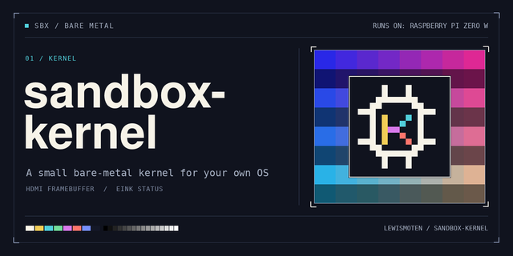

# sandbox-kernel

A small, reusable bare-metal Raspberry Pi kernel under the MIT license.
**Status: M0 board-qualified on the Zero W v1.1; M1 in progress.** The ARMv6
selector and runtime boot, show the e-ink start and status screens, log over USB
CDC, and take verified A/B kernel updates with trial, confirmation and automatic
fallback, all on the board. M1 adds the HDMI framebuffer, read-only FAT32 assets,
the SDK, a User-mode OS program loaded from the card with fault recovery, an
input event queue (synthetic USB source first) and a health heartbeat
([docs/m1.md](docs/m1.md)). [docs/js-spike.md](docs/js-spike.md) measures a JavaScript layer for building your own OS shell on it (2026-11-07). [examples/](examples/README.md) has small OS programs to copy, starting with a "Hello, world!" you can build and run in minutes.
**Making your own OS?** Start with the [OS author's guide](docs/os-authors.md): boot, what a program may do, what each ABI version adds, and how to develop over USB.

The first target is the Raspberry Pi Zero W v1.1 (BCM2835, ARM1176).
Later ports target Pi 1, 2, 3, 4, and 5 through separate board backends.
The kernel owns hardware and protects itself from a separately loaded,
user-mode OS program. Game-Maker OS is the first intended program, maintained
separately in [lewismoten/gamemaker-os](https://github.com/lewismoten/gamemaker-os).
Other OS programs use the same generic interface.

Goals:

- A familiar, versioned POSIX-style system-call subset and device paths.
- MMU isolation, bounded driver operations, watchdog recovery, and visible errors.
- HDMI graphics, e-ink status/pages, storage, input and buffered audio; wireless is planned.
- Verified USB updates with A/B kernel and OS slots and automatic fallback.
- A small image, measured in MB rather than GB; size targets await implementation.
- Original MIT code and audited permissive dependencies, developed independently
  of Circle. Vendor boot and radio firmware retain separate licenses.

Read the [design](docs/design.md), [milestones and acceptance tests](docs/milestones.md),
[credits](NOTICE.md), and [contribution rules](CONTRIBUTING.md).
The kernel is MIT-licensed and written independently; earlier Linux and Circle plans do not define it.
The current SDK is **ABI 1.10**: [audio](docs/audio-device.md) arrived in 1.8,
[OS e-ink titles/pages](docs/eink.md) in 1.9, and [two-way USB serial](docs/serial.md)
in 1.10. HDMI audio is linked with a null fallback; recorded board evidence is
limited to DMA drain counters, with listening and sustained-load qualification
still hardware-untested. The separate [PCM host core](docs/audio-host-core.md)
remains unlinked. [CEC](docs/cec.md) remains host-only and hardware-untested.
Build the default `USB_ROLE=device` Mac CDC link with `make`;
`make USB_ROLE=host all` builds the [USB boot-keyboard role](docs/usb-host-keyboard.md)
(hardware-untested, no CDC, trial-only and never confirmed). `make boot` refuses
a host runtime. Run host checks with `make test`, and assemble a boot folder
and card image with `make boot`. On 2026-11-10, test discovery finds 440 cases;
optional-tool skips are reported by the runner. The default compiler is the requested Arm GNU
15.3.rel2 installation. Dependencies are pinned and fetched without git.
See [M0 build, wire formats and board handoff](docs/m0.md) for commands, layout,
recovery policy and remaining physical tests. [M1 slice 1](docs/m1.md) adds the HDMI
framebuffer, read-only FAT32 assets and the first [SDK](sdk/README.md) headers. Claude handles flashing and commits.
The selector is `build/kernel.img`; send `build/runtime.ski` with the stdlib Mac
tool in `scripts/usb_kernel.py`. M0 uses preallocated A/B files on FAT32.

USB file commands (`python3 scripts/usb_kernel.py <port> <command>`): `put`, `putgame`, `putapp` install
files; `ls [path]` lists a folder (macOS dot items such as `.Spotlight-V100` and `._*` are skipped);
`mv <src> <dst>` moves or renames a file or folder; `rm <path>` deletes a file; `rmdir <path>` deletes an
empty folder. Paths are real card paths in upper-case 8.3 (`GAMES/DICE/DICE.GAM`). Changes reach only
`GAMES`, `POCKET`, `OS/APPS` and plain files in `OS`, never the boot, firmware, slot or control files,
`OS/CACHE` or `OS/SAVES`. A power cut during any of them loses no data (a cut move is settled on the next
boot's first change). Wire format and power-cut order are in [os-authors](docs/os-authors.md).

A separate Circle-based prototype supplied hardware observations recorded in the
[milestones](docs/milestones.md); its sources were not consulted for this implementation.
