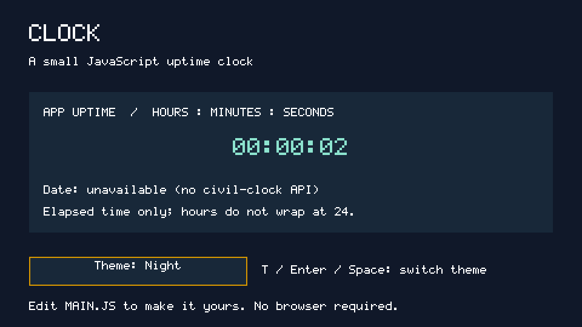
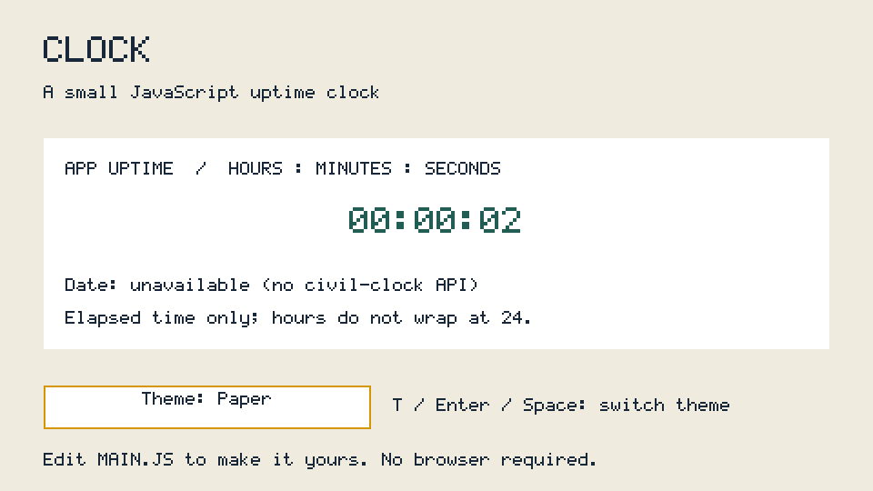

# CLOCK: make a small OS page in JavaScript

A full-screen **960×540, RGB565 (16-bit)** uptime clock with two keyboard-selected
themes. It uses only the [documented JS API](../../docs/js.md), not browser APIs.

**This is app uptime, not the time of day.** `performance.now()` measures elapsed
milliseconds since the JS runtime started (`src/js/jsrt.c`, `now_ms`), so restarting
JS.ELF resets it. Hours do not wrap at 24. The date row honestly says
`Date: unavailable (no civil-clock API)` rather than displaying an invented date.
This follows the clarified uptime requirement; a working civil-clock/date API is
still a gap.

## What it teaches

- Create `text`, `div` and `button` elements and append them to `document.body`.
- Set the screen mode and place simple pixel-sized boxes with the CSS subset.
- Change `textContent` and colors without rebuilding the page.
- Derive `hh:mm:ss` from elapsed time in a supported `setInterval` callback.
  The timer checks every 100 ms but changes text only when the second changes;
  it does not count callbacks, so a delayed callback does not slow the clock.
- Listen for a bubbling `keydown` event and reuse a button's native click action.

## Files

| File | Purpose |
| --- | --- |
| `MAIN.JS` | The entire app: layout, themes, clock and input |
| `README.md` | This guide, API gaps and reproducible host checks |
| `screenshots/*.png` | Actual host captures, converted using `tools/jsshot.py` |

No HTML file, external library, network, build step for the JS, or asset pack is
needed. The app never reads or writes a file.

## Run on Linux

From the repository root, build the host runner:

```sh
make host
```

The current Makefile links `-lc++`. On a Linux machine with GCC/libstdc++ but no
libc++, that command fails with `cannot find -lc++`. The tested **build-only**
adapter below substitutes the installed C++ library; it does not edit the
Makefile or any runtime source:

```sh
mkdir -p build
cat > build/hostcc-linux.py <<'PY'
import os, sys
os.execvp('cc', ['cc'] + ['-lstdc++' if a == '-lc++' else a for a in sys.argv[1:]])
PY
make host HOSTCC="python3 $PWD/build/hostcc-linux.py"
```

Make a host folder standing in for an SD card (all paths below are from the
repository root):

```sh
mkdir -p build/clock-card/OS/APPS
ln -sfn "$PWD/apps/CLOCK" build/clock-card/OS/APPS/CLOCK
build/host/jsrun build/clock-card /sd/OS/APPS/CLOCK --vclock --ms 2500 \
  --keys 500:20:1,520:20:0 --shot build/clock-paper.shot
python3 tools/jsshot.py build/clock-paper.shot build/clock-paper.png
```

This runner is headless: open the PNG to see its final screen. `--vclock` makes
elapsed time deterministic; omit it for a real-time host run. It does not
provide a civil clock. The example above presses **T** at 500 ms and releases
it at 520 ms, then captures Paper at `00:00:02`.

On a board, copy `MAIN.JS` to `/OS/APPS/CLOCK/MAIN.JS`, build/install `JS.ELF`
using the [JS guide](../../docs/js.md), and put these two lines in
`/OS/AUTORUN.TXT`:

```text
JS.ELF
APPS/CLOCK
```

The board must support the requested 960×540×16 mode. This example fails rather
than claiming a full-screen layout worked in a different mode. Board execution
has not been tested here.

## Controls

**Q** calls `sys.exit(0)`; **F10** is the native exit shortcut. Both return to
JS.ELF's app picker. See [exit semantics and recovery limits](../../docs/app-exit.md).

| Key | Action |
| --- | --- |
| **T** (`KeyT`) | Cycle Night → Paper → Night; auto-repeat is ignored |
| **Enter** or **Space** | Activate the initially focused Theme button; same cycle |

There are no mouse/touch controls in this API. A key release alone does not
change theme. Theme selection is in memory and resets to Night on restart.

## Screenshots and exact input sequences

Each image is a separate fresh `--vclock` run at 960×540, converted at scale 1
with `python3 tools/jsshot.py <dump.shot> <image.png>`. No reference-folder
contents are used. The first two show real elapsed-time advancement; the third
and fourth verify theme repaint and restoration at the same clock value.

| Image | `--ms` | `--keys` | Expected screen |
| --- | --- | --- | --- |
| [Night at start](screenshots/night-start.png) | 500 | omitted | Night, `00:00:00` |
| [Night after two seconds](screenshots/night-2s.png) | 2500 | omitted | Night, `00:00:02` |
| [Paper after T](screenshots/paper-2s.png) | 2500 | `500:20:1,520:20:0` | Paper, `00:00:02` |
| [Night restored after T twice](screenshots/night-restored-2s.png) | 2500 | `500:20:1,520:20:0,1000:20:1,1020:20:0` | Night, `00:00:02` |





The restored Night dump was byte-identical to Night at the same timestamp.
The start/two-second dumps differed, and Paper differed from Night. Visual
inspection confirmed the uptime, readable date-gap notice and controls without
clipping in both themes.

## Automated checks

```sh
python3 -m unittest discover -s tests -p test_js.py -v
```

`Clock` in `tests/test_js.py` executes the real app with `build/host/jsrun`:

- A test-only appended frame observer counts **exactly 120** animation callbacks
  and exits. The first frame is at time zero, so the last observes `00:00:01`.
  The app itself uses a timer, not a frame counter. The test checks the initial
  value, time advancement and the explicit date-gap notice.
- Scheduled host events verify T, ignored repeat, release-only, unrelated A,
  two T presses, Enter and Space. Numeric host codes: T=20, Enter=28, Space=57.
- Test-only clock injection checks 59 seconds, minute/hour boundaries, 24 hours
  and 100 hours. Those long-uptime cases are not claims of days-long execution.
- The normal unmodified app produces a complete 960×540×16 screen dump.
- Smoke observers reject `Uncaught`, `(it threw)`, `FAIL` and unsupported API
  warnings as well as a nonzero process status. Exit status alone is not enough:
  this runtime can catch and log an app exception while returning zero.

The JS suite passed, including existing PROBE and HELLO game/return checks. The
full host suite ran 71 tests: 64 passed, 7 skipped for missing optional fixtures
or the Arm toolchain. BENCH separately reached `BENCH done 27 results` on the
virtual clock (its zero-millisecond timings are not hardware performance data).

## Customize it

1. Edit the named colors in `themes` to recolor the whole app. Add another theme
   object with the same fields to extend the cycle.
2. Edit the `box(...)` calls for labels and positions. Font sizes 9, 18, 27 and
   36 px are supported. Text does not automatically wrap; keep each line short.
3. Change `KeyT` in the document listener and update the visible hint and this
   README if you choose another shortcut.
4. Keep the clock derived from `performance.now()`. Do not replace it with a
   callback counter or pretend `Date` supplies a portable civil clock.

## API gaps and limits

- **Civil/real-time clock and calendar date:** no documented RTC, wall-clock or
  time-setting API. On the board `_gettimeofday` reports boot uptime; on the
  host `Date` may instead use host wall time and is not controlled by `--vclock`.
  Neither is a portable basis for a real date here. No C runtime changes made.
- **Boot uptime:** `performance.now()` subtracts JS runtime start, so this page
  shows *app* uptime, not an independently measured OS boot age.
- **Persistence:** no write API; theme selection is intentionally temporary.
- **Layout/input:** fixed pixel layout and bitmap font; no CSS stylesheet,
  automatic text wrapping, mouse or touch. Physical board/video/keyboard testing
  remains unverified; Linux scheduled input is verified.
